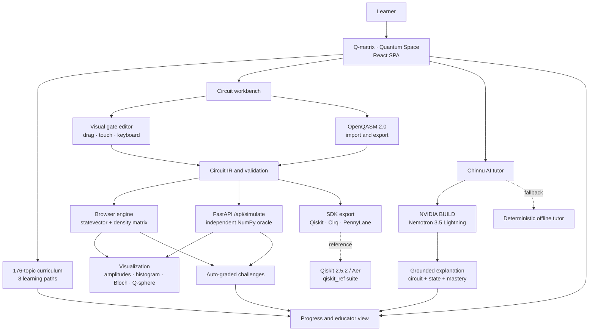

# ⚛️ Q-matrix

**VTU-QFF-HC-0024** | Tier: **Both**

**Quantum Space** — an NVIDIA-powered, interactive quantum algorithm learning platform.

---

| | |
|---|---|
| **Team** | Q-matrix |
| **Team ID** | VTU-QFF-HC-0024 |
| **Tier** | Both |
| **Repository** | [vtu-hc-q-matrix](https://github.com/vtu-qiskit-fall-fest-2026/vtu-hc-q-matrix.git) |
| **Organisation** | [vtu-qiskit-fall-fest-2026](https://github.com/vtu-qiskit-fall-fest-2026) |
| **Event** | VTU-QFF Hackathon — VTU-Qiskit Fall Fest 2026 |

**Links:** [Live demo](https://chinmayrerc.github.io/q-matrix/) · [Hardware & India hub](https://chinmayrerc.github.io/q-matrix/#/hardware) · [Demo video (2 min)](https://github.com/vtu-qiskit-fall-fest-2026/vtu-hc-q-matrix/releases/download/v1.1/q-matrix-demo.mp4) · [API health](https://q-matrix.onrender.com/api/health) · [Submission deck](https://github.com/vtu-qiskit-fall-fest-2026/vtu-hc-q-matrix/releases/download/v1.1/VTU-QFF-HC-0024.pptx) — 10-slide organiser template

---

## 📌 Table of Contents

- [Team Members](#-team-members-github-ids)
- [Problem Statement](#-problem-statement)
- [Proposed Solution](#-proposed-solution)
- [Approach & Architecture](#-approach--architecture)
- [Tech Stack](#️-tech-stack)
- [Project Structure](#-project-structure)
- [How to Run](#-how-to-run)
- [How to Push Code](#-how-to-push-code)
- [Submission Checklist](#-submission-checklist)
- [Resources](#-resources)
- [License](#-license)

---

## 👥 Team Members (GitHub IDs)

| # | Name | GitHub Username | Role |
|---|---|---|---|
| 1 | Chinmay R | [ChinmayRERC](https://github.com/ChinmayRERC) | Team Lead |
| 2 | M Naveen | [Naveenmuchetty-67](https://github.com/Naveenmuchetty-67) | Developer 1 |
| 3 | Thulasi Ram M | [Ram0528](https://github.com/Ram0528) | Developer 2 |

---

## ❓ Problem Statement

### AI-Based Interactive Quantum Algorithm Learning Platform

**Background:**

Quantum computing is a transformative technology with significant impact across scientific and industrial domains. However, education in this field remains challenging due to the abstract nature of core concepts such as qubits, superposition, entanglement, and quantum algorithms.

Existing learning resources are often static, heavily theoretical, and lack hands-on interaction. Limited access to real quantum hardware further restricts practical learning. There is a strong need for an integrated, interactive, and intelligent platform that combines theoretical instruction, visual circuit design, real-time simulation, and personalized AI-based guidance to accelerate quantum education and workforce development.

**Description:**

The goal is to develop an AI-powered interactive web-based platform that enables students, researchers, and professionals to learn, design, simulate, and visualize quantum algorithms.

The platform offers structured learning modules covering quantum computing fundamentals, circuit design, and standard quantum algorithms. Users can construct quantum circuits through a drag-and-drop interface or by writing code, execute them on multiple quantum simulators, and visualize quantum states and measurement outcomes. AI-assisted features provide real-time explanations, error detection, optimization suggestions, and personalized learning paths. The system supports major quantum software development kits and promotes collaborative and modular learning.

**Why it matters:**

Quantum computing education requires more than theoretical explanations. Students need an accessible environment where they can experiment with quantum circuits, observe quantum behavior, understand complex algorithms, and learn from their mistakes.

Q-matrix bridges the gap between theoretical quantum computing knowledge and practical implementation through interactive simulation, visualization, and intelligent educational assistance.

**Why hardware matters:** a circuit diagram is not the machine. Gate counts hide what actually limits a quantum computer — qubit quality, coherence, connectivity, native gate sets, SWAP routing and readout speed. Q-matrix adds hardware-aware device profiles for India's National Quantum Mission targets (RRI Bengaluru's `anviQa` neutral-atom and trapped-ion programmes) and IBM's superconducting Heron, so learners see how the same circuit compiles, decoheres and is measured on real architectures. See the [Hardware & India hub](https://chinmayrerc.github.io/q-matrix/#/hardware).

**Track / Category:** Quantum Computing | AI-Powered Education | Interactive Web Application

---

## 💡 Proposed Solution

### Objectives

- Design and develop an interactive web-based platform for learning quantum computing and quantum algorithms.
- Provide graphical drag-and-drop and code-based quantum circuit design tools.
- Execute circuits with a browser statevector/density engine, cross-check them against an independent NumPy backend, and verify Qiskit 1.0+ reference algorithms against Aer.
- Integrate AI-assisted tutoring for concept explanation, code assistance, debugging, and personalized learning recommendations.
- Support visualization of quantum states, Bloch spheres, measurement probabilities, and circuit execution results.
- Provide structured learning modules covering qubits, quantum gates, superposition, entanglement, and quantum algorithms.
- Include assessment modules, coding challenges, progress tracking, and educator dashboards.
- Promote collaborative and modular quantum learning through OpenQASM and Qiskit/Cirq/PennyLane export.

### Expected Solution

A comprehensive AI-based interactive quantum learning platform that integrates education, programming, simulation, visualization, and intelligent tutoring.

Q-matrix is delivered as a single-origin web platform with a 176-topic curriculum, an executable circuit workbench, an independent Python oracle, an AI tutor grounded in the learner's live state, and an educator view for mastery and learning-gain analysis. It is designed to be accessible, extensible, and useful without paid quantum cloud credits.

### Solution

**Q-matrix** is an AI-powered interactive quantum learning platform that lets learners study quantum concepts, construct circuits visually or through OpenQASM, execute simulations, and analyze quantum behavior through interactive visualizations.

An integrated AI tutor — **Chinnu** — assists with conceptual explanations, circuit debugging, optimization suggestions, and personalized learning recommendations. It receives the learner's actual circuit, state summary, and mastery context rather than answering from a generic prompt alone.

### Key Idea

**Learn → Build → Simulate → Visualize → Understand → Improve**

Q-matrix combines a visual quantum circuit editor, a quantum simulation engine, interactive visualization, and an AI-assisted tutoring system within one web-based learning environment.

### Why This Works

Traditional quantum learning resources often separate theoretical content from practical execution. Q-matrix brings both together by enabling learners to experiment with quantum circuits while receiving contextual explanations and feedback.

The approach emphasizes practical experimentation, visual understanding, and personalized learning rather than passive theoretical instruction alone.

### What ships in the platform

| Area | Capabilities |
|---|---|
| **Learn** | 176 topics across 20 domains, 8 learning paths, prerequisite validation, and a seven-stage Virtual Lab: Aim → Theory → Pretest → Procedure → Simulation → Posttest → References |
| **Build** | 19 gate types, drag/touch/keyboard placement, mid-circuit measurement, classical feed-forward, noise presets, hardware device profiles, OpenQASM 2.0 round-trip, and Qiskit/Cirq/PennyLane export |
| **Simulate** | TypeScript statevector and density-matrix engines, independent FastAPI/NumPy oracle, ideal vs noisy runs, device-derived noise, SWAP routing and timing estimates, measurement collapse, and cross-check results |
| **Visualize** | Amplitudes, probabilities, histograms, Bloch spheres, Q-sphere, circuit diagrams, and a 3D Quantum Galaxy knowledge map with a 2D SVG fallback |
| **Practice** | 13 verified circuit templates, 11 auto-graded challenges, 12 badges, XP/levels, daily streaks, and daily/weekly quests |
| **Teach** | Bayesian Knowledge Tracing mastery, Hake learning-gain tracking, per-topic analytics, and CSV/JSON educator export |
| **AI** | NVIDIA Nemotron tutor and study planner, optional Anthropic fallback, deterministic offline tutor, and server-side-only API keys |

---

## 🧩 Approach & Architecture

### System Architecture



The browser engine is the fast path. The FastAPI service runs a deliberately independent NumPy implementation of the same simulation contract: when both engines are asked to simulate the same deterministic circuit, any disagreement exposes a bug in one of them. The workbench surfaces the comparison in its cross-check dialog.

### Workflow

**1. Input — user interaction**

Users interact with Q-matrix through a web interface. They can select learning modules, create circuits using drag-and-drop components, or write/import OpenQASM in the workbench.

**2. Circuit construction and validation**

The platform converts supported visual operations into a typed internal circuit representation and validates it before execution. Validation checks include:

- Invalid gate placement or overlapping qubits
- Missing or incorrect qubit references
- Unsupported gates or parameters
- Invalid measurement/feed-forward conditions
- Incompatible simulator options
- Circuit-size limits

**3. Quantum core — circuit execution**

Validated circuits run in the browser statevector engine or the density-matrix engine when noise is enabled. The independent FastAPI/NumPy service can cross-check deterministic circuits. Qiskit 1.0+ reference implementations in [`qiskit_ref/`](./qiskit_ref) are verified against Aer.

Example algorithms include:

- Bell State Preparation
- Quantum Teleportation with feed-forward
- Deutsch–Jozsa Algorithm
- Bernstein–Vazirani Algorithm
- Grover's Search Algorithm
- Quantum Fourier Transform
- Quantum Phase Estimation

**4. Post-processing — quantum state analysis**

Simulation results are transformed into user-friendly representations:

- Measurement counts and shot histograms
- Probability distributions
- Statevector amplitudes and phases
- Single-qubit Bloch sphere visualizations
- Q-sphere representations
- Ideal versus sampled measurement comparisons
- Entropy and concurrence for mixed states

**5. AI-based intelligent assistance**

The AI tutor receives the learner's question plus relevant circuit details, simulation results, topic context, and mastery state. It provides contextual guidance to help learners understand their quantum programs.

Implemented capabilities:

- Explain quantum gates and algorithms
- Interpret simulation outcomes
- Identify possible circuit errors
- Recommend debugging steps
- Suggest possible optimizations
- Generate educational hints
- Recommend subsequent learning topics

Circuit correctness is determined by deterministic validation and simulator results rather than relying on AI-generated explanations. AI providers are tried in order: NVIDIA → Anthropic (optional) → deterministic offline fallback.

**6. Output — interactive learning experience**

Users receive circuit diagrams, simulation results, visualizations, AI explanations, and actionable educational feedback. The platform records mastery, learning gain, XP, streaks, and challenge progress, and recommends suitable exercises based on performance.

### Qubit ordering

Little-endian throughout, matching Qiskit: qubit 0 is the least-significant bit. The Bell state occupies statevector indices 0 and 3. Display strings are little-endian with q0 leftmost, so a three-qubit `|100⟩` means qubit 0 is 1 and the histogram key `100` is the same basis state.

### Mastery and AI grounding

Each topic has a Bayesian Knowledge Tracing state (`pInit`, `pTransit`, `pSlip`, `pGuess`, `pKnown`). Correct and incorrect answers update the posterior; mastery decays toward the prior with a 28-day time constant. Recommendations order topics by prerequisite readiness and lowest mastery.

`POST /api/ai/tutor` receives the learner's question plus circuit, state summary, mastery, and recent chat. The backend prefers NVIDIA BUILD (`nvidia/nemotron-3.5-lightning-30b-a3b` with thinking disabled for fast replies), can fall back to Anthropic, and finally to a deterministic answer derived from the live statevector. The browser never receives provider credentials.

### Verification

```text
120 Vitest tests  +  12 API tests  +  15 Qiskit tests  =  147 automated checks
28/28 NumPy oracle checks
QFT vs Qiskit QFTGate: max error 1.2e-12
Browser vs NumPy deterministic templates: ≤ 1.3e-15 max amplitude difference
```

Pure-state concurrence uses the closed form `C = 2|ψ₀ψ₃ − ψ₁ψ₂|`; mixed and noisy density matrices use Wootters' spin-flip formula. Both are checked against independent oracles.

---

## 🛠️ Tech Stack

| Layer | Technology |
|---|---|
| Frontend | React 19, TypeScript, Vite |
| UI / motion | Custom CSS, Lucide icons, Framer Motion |
| Circuit builder | Custom React/SVG drag-and-drop editor with touch and keyboard placement |
| Code / interchange | OpenQASM 2.0 parser and serializer; Qiskit, Cirq and PennyLane code export |
| Backend API | FastAPI, Pydantic, Uvicorn |
| Primary quantum SDK | Qiskit `qiskit[all]~=2.5.2` (Qiskit 1.0+ compatible) |
| Runtime simulation | TypeScript statevector/density-matrix engine; FastAPI/NumPy independent oracle |
| Reference verification | Qiskit 2.5.2 + Qiskit Aer |
| Additional SDKs | Cirq and PennyLane code export; runtime adapters are future work |
| Visualization | SVG, Canvas, Three.js / React Three Fiber, Q-sphere, Bloch sphere |
| AI assistance | NVIDIA BUILD Nemotron 3.5 Lightning; optional Anthropic fallback; deterministic offline tutor |
| Persistence | Zustand + browser localStorage |
| Authentication | Not required for the demo; progress is stored locally |
| Database | No server-side database required |
| Testing | Vitest, Pytest, NumPy oracle, Qiskit Aer |
| Deployment | Render Docker web service; GitHub Pages static demo |
| Version control | Git + GitHub |
| Development | Node 20+, Python 3.11+, VS Code / terminal |

---

## 📁 Project Structure

```text
vtu-hc-q-matrix/
├── README.md
├── LICENSE
├── package.json
├── package-lock.json
├── vite.config.ts
├── vitest.config.ts
├── tsconfig.json
├── tsconfig.app.json
├── index.html
├── Dockerfile
├── render.yaml
├── .env.example
│
├── src/
│   ├── App.tsx
│   ├── main.tsx
│   ├── components/
│   │   ├── CircuitBoard.tsx
│   │   ├── Composer.tsx
│   │   ├── LessonView.tsx
│   │   ├── Challenges.tsx
│   │   ├── Galaxy.tsx
│   │   ├── Progress.tsx
│   │   ├── TutorPanel.tsx
│   │   └── Visuals.tsx
│   ├── content/
│   │   └── topics.generated.ts
│   ├── lib/
│   │   ├── quantum/
│   │   │   ├── circuit.ts
│   │   │   ├── simulator.ts
│   │   │   ├── qasm.ts
│   │   │   ├── analysis.ts
│   │   │   └── templates.ts
│   │   ├── api.ts
│   │   ├── challenges.ts
│   │   ├── lessons.ts
│   │   ├── mastery.ts
│   │   ├── gamification.ts
│   │   └── tutor.ts
│   ├── store/
│   │   └── useAppStore.ts
│   └── styles/
│       └── app.css
│
├── apps/
│   └── api/
│       ├── main.py
│       ├── requirements.txt
│       └── test_main.py
│
├── qiskit_ref/
│   ├── README.md
│   ├── algorithms.py
│   ├── requirements.txt
│   └── test_algorithms.py
│
├── scripts/
│   ├── build_topics.py
│   ├── verify-templates.py
│   ├── reference.py
│   └── ground-truth.py
│
├── specs/
│   ├── QUANTUM_PLATFORM_SPEC.md
│   └── QUANTUM_TOPIC_MAP.md
│
├── submission/
│   ├── README.md
│   ├── VTU-QFF-HC-0024.pptx
│   ├── build_deck.py
│   ├── template.pptx
│   └── assets/
│       ├── ghz_circuit.png
│       └── results.png
│
└── .github/
    └── workflows/
        └── pages.yml
```

---

## 🚀 How to Run

### Prerequisites

- Node.js 20 or newer
- Python 3.11 or newer
- Git
- A GitHub account with repository access

### 1. Clone the Repository

```bash
git clone https://github.com/vtu-qiskit-fall-fest-2026/vtu-hc-q-matrix.git
cd vtu-hc-q-matrix
```

### 2. Install Frontend Dependencies

```bash
npm ci
```

### 3. Start the Frontend

```bash
npm run dev
```

Open <http://localhost:3000>. The browser simulator is self-contained and the app works without the API.

### 4. Optional — Start the FastAPI Backend

The backend enables the independent NumPy cross-check and live AI tutor.

```bash
python3 -m venv .venv
source .venv/bin/activate

pip install --upgrade pip
pip install -r apps/api/requirements.txt

cp .env.example .env
# Add NVIDIA_API_KEY to .env for live tutoring.

npm run api
```

The API runs at <http://localhost:8000> and exposes interactive docs at <http://localhost:8000/docs>. The Vite dev server proxies `/api` to `http://127.0.0.1:8000`.

Windows PowerShell:

```powershell
python -m venv .venv
.venv\Scripts\Activate.ps1
pip install -r apps/api/requirements.txt
npm run api
```

### 5. Environment Variables

| Variable | Required | Purpose |
|---|---|---|
| `NVIDIA_API_KEY` | No | Enables the NVIDIA tutor and study planner. Server-side only. |
| `NVIDIA_MODEL` | No | Defaults to `nvidia/nemotron-3.5-lightning-30b-a3b`. |
| `NVIDIA_BASE_URL` | No | Defaults to `https://integrate.api.nvidia.com/v1`. |
| `ANTHROPIC_API_KEY` | No | Optional fallback provider. |
| `ANTHROPIC_MODEL` | No | Defaults to `claude-sonnet-4-5`. |

Without any key, the API returns the deterministic fallback, so demos never break. Never commit a real `.env` or expose keys in the browser.

### 6. Run Tests

```bash
npx vitest run                       # 120 frontend tests
npx tsc -b                           # TypeScript type-check
npm run build                        # production build
python3 -m pytest apps/api -q        # 12 API tests
python3 scripts/verify-templates.py  # 28/28 NumPy oracle checks
```

Qiskit 1.0+ reference suite:

```bash
python3 -m venv .venv-qiskit
source .venv-qiskit/bin/activate
pip install -r qiskit_ref/requirements.txt
python -m pytest qiskit_ref -q       # 15 tests
python -m qiskit_ref.algorithms      # run the algorithm demo
```

Total: **147 automated checks** (120 + 12 + 15), plus **28/28** NumPy oracle checks.

### 7. Build and Deploy

Production build:

```bash
npm run build
```

The included [`Dockerfile`](./Dockerfile) builds the React SPA, installs the FastAPI service, and serves both from one origin. [`render.yaml`](./render.yaml) defines the Render web service and health check.

For the static GitHub Pages demo, [`.github/workflows/pages.yml`](./.github/workflows/pages.yml) builds with `VITE_BASE=/q-matrix/` and deploys `dist` on every push to `main`. Set the repository variable `VITE_API_URL` to `https://q-matrix.onrender.com` to connect the Pages demo to the Render API.

### API endpoints

| Endpoint | Description |
|---|---|
| `GET /api/health` | Engine, provider, model and feature status |
| `GET /api/experiments` | Lesson experiment catalogue |
| `POST /api/simulate` | NumPy statevector simulation; returns `agrees` / `max_abs_diff` when expected probabilities are supplied |
| `POST /api/ai/tutor` | Socratic tutor with NVIDIA → Anthropic → local fallback |
| `POST /api/ai/plan` | Agentic study plan for the next session |

---

## 🔁 How to Push Code

### Configure Git (First Time Only)

```bash
git config --global user.name "Your Name"
git config --global user.email "you@example.com"
```

### Add the VTU Mirror (Optional)

```bash
git remote add org https://github.com/vtu-qiskit-fall-fest-2026/vtu-hc-q-matrix.git
```

### Everyday Workflow

```bash
# 1. Get the latest changes
git checkout main
git pull origin main

# 2. Create a branch
git checkout -b feature/my-task

# 3. Stage and commit
git add .
git commit -m "feat: add quantum circuit builder"

# 4. Push changes
git push -u origin feature/my-task

# 5. Open a Pull Request on GitHub

# 6. After approval and merge
git checkout main
git pull origin main
git branch -d feature/my-task
```

### Commit Message Convention

| Prefix | Meaning |
|---|---|
| `feat:` | New feature |
| `fix:` | Bug fix |
| `docs:` | Documentation changes |
| `test:` | Adding or fixing tests |
| `refactor:` | Code restructuring |
| `chore:` | Maintenance and configuration |

### Useful Commands

```bash
git status
git log --oneline -10
git diff
git stash
git pull --rebase
```

### Collaboration Guidelines

- Work on individual feature branches.
- Pull recent changes before starting new work.
- Submit Pull Requests for review.
- Resolve merge conflicts before merging.
- Commit frequently with descriptive messages.
- Ensure implemented features are tested before submission.

---

## ✅ Submission Checklist

- [x] Repository created and public
- [x] Team members listed with GitHub IDs
- [x] README.md updated with project information
- [x] Problem statement and proposed solution documented
- [x] Interactive quantum circuit builder implemented
- [x] Qiskit 1.0+ reference algorithms and Aer verification integrated
- [x] Circuit validation implemented
- [x] Quantum visualization implemented
- [x] AI tutoring functionality implemented
- [x] Structured learning modules added
- [x] Assessment functionality implemented
- [x] Backend and frontend integrated
- [x] Dependencies documented
- [x] Automated tests passing
- [x] Project runs from a clean clone
- [x] Latest code committed to `main`
- [x] Live demo and 10-slide submission deck included
- [x] 24-second demo video published (every frame is the real product, captured from the live deployment)
- [ ] Short project summary submitted on the hackathon portal

---

## 📚 Resources

| Resource | Link |
|---|---|
| Git & Collaboration Handbook | [Git & Collaboration Handbook](https://github.com/vtu-qiskit-fall-fest-2026/vtu-hc-guide-git-and-collaboration) |
| Problem Statements & Solutions | [Problem Statements, Solutions & Terms](https://github.com/vtu-qiskit-fall-fest-2026/vtu-hc-guide-problem-and-solution) |
| README Guide | [README Guide & Template](https://github.com/vtu-qiskit-fall-fest-2026/vtu-hc-guide-readme-template) |
| Qiskit Documentation | <https://quantum.cloud.ibm.com/docs/> |
| Qiskit Aer | <https://qiskit.github.io/qiskit-aer/> |
| IBM Quantum Platform | <https://quantum.cloud.ibm.com/> |
| IBM Quantum Learning | <https://quantum.cloud.ibm.com/learning> |
| PennyLane | <https://pennylane.ai/> |
| Google Cirq | <https://quantumai.google/cirq> |
| GitHub Documentation | <https://docs.github.com/> |
| Live demo | <https://chinmayrerc.github.io/q-matrix/> |
| Demo video (2 min) | [watch/download](https://github.com/vtu-qiskit-fall-fest-2026/vtu-hc-q-matrix/releases/download/v1.1/q-matrix-demo.mp4) · in-repo [`docs/q-matrix-demo.mp4`](./docs/q-matrix-demo.mp4) · poster [`docs/q-matrix-demo-poster.jpg`](./docs/q-matrix-demo-poster.jpg) |
| API health | <https://q-matrix.onrender.com/api/health> |
| Submission deck | [`submission/VTU-QFF-HC-0024.pptx`](./submission/VTU-QFF-HC-0024.pptx) · [download](https://github.com/vtu-qiskit-fall-fest-2026/vtu-hc-q-matrix/releases/download/v1.1/VTU-QFF-HC-0024.pptx) |

---

## 📄 License

Released under the MIT License. See [`LICENSE`](./LICENSE).

Copyright © 2026 Q-matrix — VTU-QFF-HC-0024.

---

**Q-matrix** · Team ID `VTU-QFF-HC-0024` · Tier `Both`

Built with ⚛️ Qiskit for the VTU-QFF Hackathon

[⬆ Back to Top](#-q-matrix)
