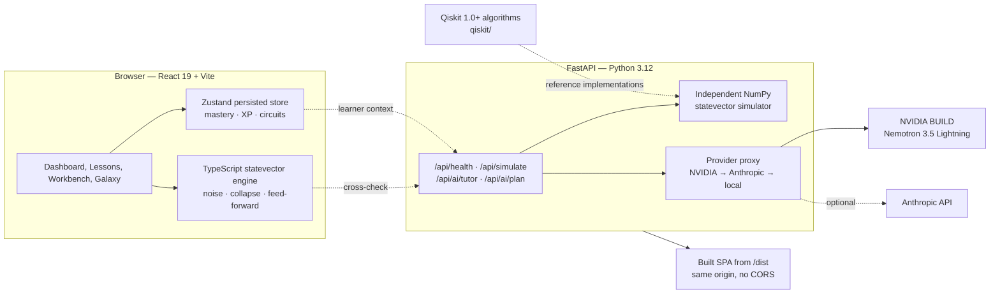

# Q-matrix · Quantum Space

**An agent-reviewed, NVIDIA-powered quantum learning platform for beginners and advanced learners.**

Q-matrix turns quantum computing from a wall of algebra into a guided lab. Learners follow a 176-topic curriculum, drag gates onto a circuit, run it on a verified statevector simulator, and ask **Chinnu** — an AI tutor grounded in the live circuit — for a Socratic hint.

- **Live demo:** <https://chinmayrerc.github.io/q-matrix/>
- **Repository:** <https://github.com/vtu-qiskit-fall-fest-2026/vtu-hc-q-matrix>
- **Team:** VTU-QFF-HC-0024 — Chinmay R ([@ChinmayRERC](https://github.com/ChinmayRERC)), M Naveen ([@Navenmuchetty-67](https://github.com/Navenmuchetty-67)), Thulasi Ram M ([@Ram0528](https://github.com/Ram0528))
- **License:** MIT

> The GitHub Pages demo runs the full browser application. The NVIDIA tutor and the independent NumPy cross-check activate automatically when the FastAPI backend is deployed (see [Deploy](#deploy)); without it the app stays fully usable with the deterministic offline tutor.

---

## Why it is different

| Most learning sites | Q-matrix |
| --- | --- |
| Video + quiz | **Seven-stage Virtual Lab** with a pretest, guided procedure, live simulation and posttest for every topic |
| Static circuit pictures | **Executable workbench** with 19 gates, noise, mid-circuit measurement, feed-forward, OpenQASM and SDK export |
| Answers from a generic chatbot | **Chinnu**, grounded in the learner's actual amplitudes, circuit and mastery state |
| One path for everyone | **Beginner / advanced modes**, Bayesian Knowledge Tracing, prerequisite-aware recommendations |
| Graded by string matching | Challenges **re-simulate the learner's circuit** and check its state |

---

## What is in the box

**Learn**
- 176 topics across 20 domains, prerequisite validation, 8 learning paths
- Seven-stage Virtual Lab: Aim → Theory → Pretest → Procedure → Simulation → Posttest → References
- Hake normalised learning-gain tracking (pre/post), per learner, exportable

**Build**
- Drag-and-drop circuit board; tap-to-arm placement for touch and keyboard users
- 19 gate types including Toffoli, Fredkin, controlled rotations and measurement
- Classical feed-forward (`X q[2] if c1==1`) used by the teleportation template
- Live amplitudes, probabilities, histogram, Q-sphere and Bloch views
- OpenQASM 2.0 round-trip plus Qiskit, Cirq and PennyLane code export
- Ideal and noisy simulation (light / moderate / heavy presets)
- 12 verified circuit templates, including Bell, GHZ, QFT, Grover, teleportation and phase estimation

**Play**
- XP curve, levels, daily streaks, 12 badges, daily and weekly quests
- 11 auto-graded circuit challenges
- Quantum Galaxy: 3D knowledge map with a 2D SVG fallback
- Bayesian Knowledge Tracing mastery that decays over time

**Teach**
- Educator view with per-topic mastery, pre/post scores and CSV/JSON export
- Deterministic offline data export

**AI**
- `POST /api/ai/tutor` — Socratic tutor with NVIDIA Nemotron as the primary model
- `POST /api/ai/plan` — agentic study plan built from the learner's mastery and goals
- Graceful degradation: NVIDIA → Anthropic (optional) → deterministic offline tutor
- API keys are read server-side only; the browser never receives them

---

## Architecture



The browser engine is the fast path. The NumPy service is deliberately an *independent* implementation: when both are asked to simulate the same circuit, a disagreement exposes a bug in one of them. The UI surfaces that comparison in the workbench cross-check dialog.

### Qubit ordering

Little-endian throughout, matching Qiskit: qubit 0 is the least-significant bit. The Bell state occupies statevector indices 0 and 3. Display strings are MSB-first, so a three-qubit `|100⟩` means qubit 0 is 1.

### Mastery model

Each topic has a Bayesian Knowledge Tracing state (`pInit`, `pTransit`, `pSlip`, `pGuess`, `pKnown`). Correct and incorrect answers update the posterior; mastery decays toward the prior with a 28-day time constant. `recommendTopics` orders by prerequisite readiness and lowest mastery, so the dashboard always suggests a reachable next step.

### Tutor

`POST /api/ai/tutor` receives the learner's question plus circuit, state summary, mastery and recent chat. The backend prefers NVIDIA BUILD (`nvidia/nemotron-3.5-lightning-30b-a3b` with thinking disabled for sub-2-second replies), can fall back to Anthropic, and finally to a deterministic answer derived from the live statevector. The client never holds credentials.

---

## Quick start

Requirements: Node 20+, Python 3.11+.

```bash
git clone https://github.com/vtu-qiskit-fall-fest-2026/vtu-hc-q-matrix.git
cd vtu-hc-q-matrix

npm ci
npm run dev          # http://localhost:3000
```

The browser simulator is self-contained; the app works without the API.

To enable the NumPy cross-check and live AI:

```bash
python3 -m venv .venv
source .venv/bin/activate
pip install -r apps/api/requirements.txt

cp .env.example .env      # add NVIDIA_API_KEY
npm run api               # http://localhost:8000/docs
```

The Vite dev server proxies `/api` to `http://127.0.0.1:8000`.

### Environment variables

| Variable | Required | Purpose |
| --- | --- | --- |
| `NVIDIA_API_KEY` | No | Enables the NVIDIA tutor and study planner. Server-side only. |
| `NVIDIA_MODEL` | No | Defaults to `nvidia/nemotron-3.5-lightning-30b-a3b`. |
| `NVIDIA_BASE_URL` | No | Defaults to `https://integrate.api.nvidia.com/v1`. |
| `ANTHROPIC_API_KEY` | No | Optional fallback provider. |
| `ANTHROPIC_MODEL` | No | Defaults to `claude-sonnet-4-5`. |

Without any key the API returns the deterministic fallback, so demos never break.

---

## Tests and verification

```bash
npm test                          # 106 unit tests across 6 files
npx tsc -b                        # type-check
npm run build                     # production build
python3 -m pytest apps/api -q     # 12 API tests
python3 scripts/verify-templates.py  # 28/28 NumPy oracle checks
```

The browser engine is cross-checked against the NumPy implementation for all deterministic templates, matching to ≤ 1.3e-15 max absolute amplitude difference. Concurrence uses the closed form `C = 2|ψ₀ψ₃ − ψ₁ψ₂|`, validated against Wootters' formula to 2.3e-8.

The initial route ships ~111 kB gzipped; three.js and the workbench load on demand.

---

## API

| Endpoint | Description |
| --- | --- |
| `GET /api/health` | Engine, provider, model and feature status |
| `GET /api/experiments` | Lesson experiment catalogue |
| `POST /api/simulate` | NumPy statevector simulation; returns `agrees` / `max_abs_diff` when expected probabilities are supplied |
| `POST /api/ai/tutor` | Socratic tutor with NVIDIA → Anthropic → local fallback |
| `POST /api/ai/plan` | Agentic study plan for the next session |

---

## Deploy

### Option A — single Render Docker service (full AI)

The [`Dockerfile`](./Dockerfile) builds the React app with Node 20, then runs FastAPI on Python 3.12 and serves both the SPA and `/api` from one origin.

1. Open the Render Blueprint flow:
   <https://dashboard.render.com/blueprint/new?repo=https://github.com/vtu-qiskit-fall-fest-2026/vtu-hc-q-matrix>
2. Apply [`render.yaml`](./render.yaml).
3. Set `NVIDIA_API_KEY` when prompted (it is `sync: false` and never committed).
4. Wait for the health check at `/api/health` to pass.

### Option B — GitHub Pages (static demo)

The workflow at [`.github/workflows/pages.yml`](./.github/workflows/pages.yml) builds with `VITE_BASE=/q-matrix/` and deploys `dist` to Pages on every push to `main`. The app uses hash routing, so deep links work without rewrites.

To connect the static site to a deployed API, set the repository variable `VITE_API_URL` to the Render URL (for example `https://q-matrix.onrender.com`) and re-run the workflow. Without it, the site uses the offline tutor.

---

## Qiskit 1.0+ algorithms

The [`qiskit/`](./qiskit) folder contains standalone reference implementations of the core algorithms used in the curriculum, targeting **Qiskit SDK 1.0+ / 2.x** with `StatevectorSampler` and the primitives API. Each module is runnable, and the test suite checks statevectors and measurement statistics against the same oracles used by the web app.

```bash
pip install -r qiskit/requirements.txt
python -m pytest qiskit -q
```

Planned modules: Bell/GHZ preparation, Deutsch–Jozsa, Bernstein–Vazirani, Grover, QFT and inverse QFT, phase estimation, teleportation with `if_test` feed-forward, and a noise-aware sampler example. See [`qiskit/README.md`](./qiskit/README.md) for conventions and expected output.

---

## Known limitations

- Teleportation uses mid-circuit measurement and classical feed-forward. The NumPy `/api/simulate` endpoint intentionally rejects conditional circuits (HTTP 422); the browser engine handles them. QASM export preserves feed-forward using one classical bit per measured qubit; Qiskit export uses `if_test`.
- Cirq and PennyLane exports list feed-forward gates unconditionally and include a note to wire up `with_classical_controls` / `qml.cond` manually.
- The Python API ships the independent cross-check simulator. The Qiskit reference algorithms are separate, runnable modules rather than the runtime for the web workbench.
- The bundle includes three.js for the Galaxy and Q-sphere views, so first load of those routes is heavier than the dashboard.

---

## Content pipeline

```bash
python3 scripts/build_topics.py   # regenerate src/content/topics.generated.ts
python3 scripts/verify-templates.py
```

`build_topics.py` reads `specs/QUANTUM_TOPIC_MAP.md`, validates that every prerequisite exists, rejects cycles, and emits typed content with 20 domains and 8 learning paths.

---

## License

MIT — see [LICENSE](./LICENSE).
